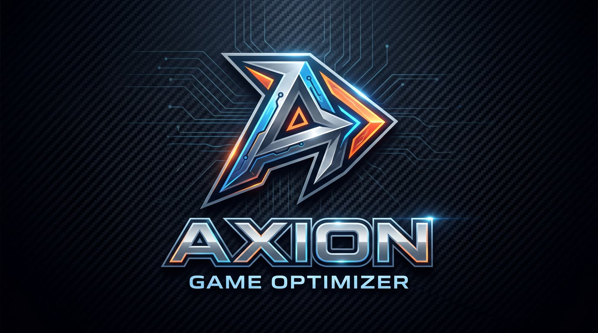
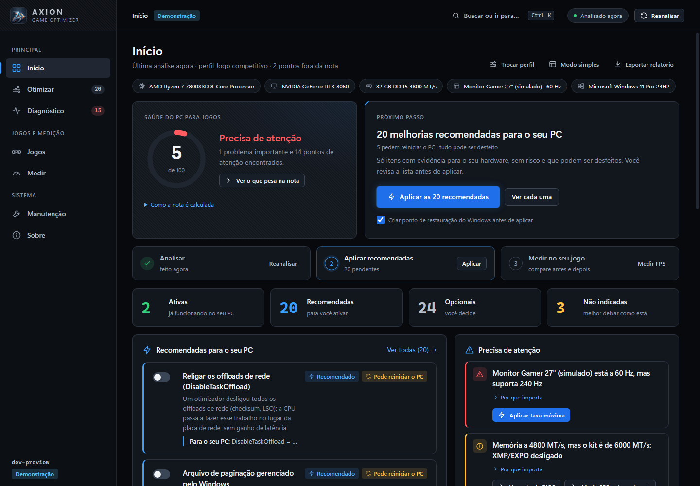
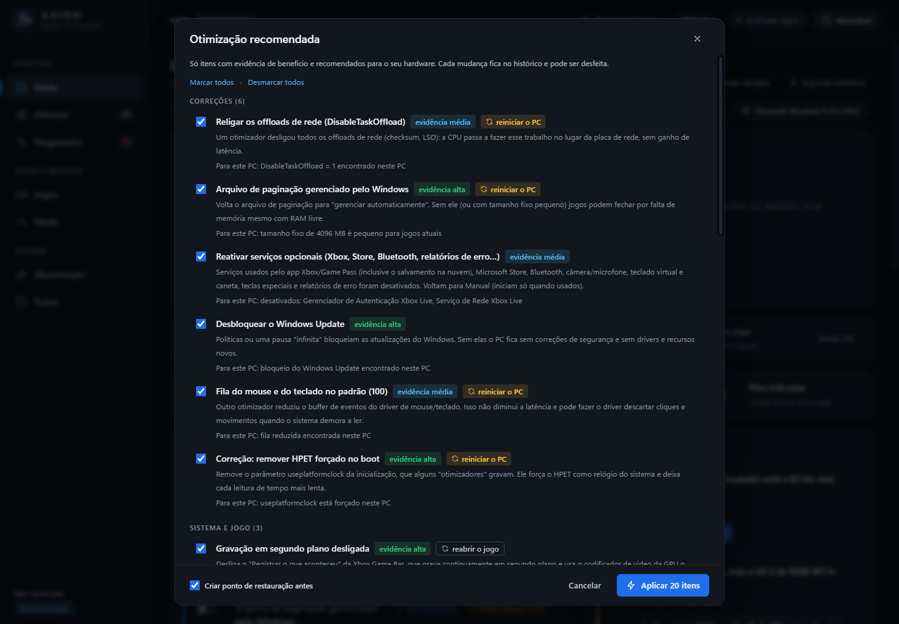
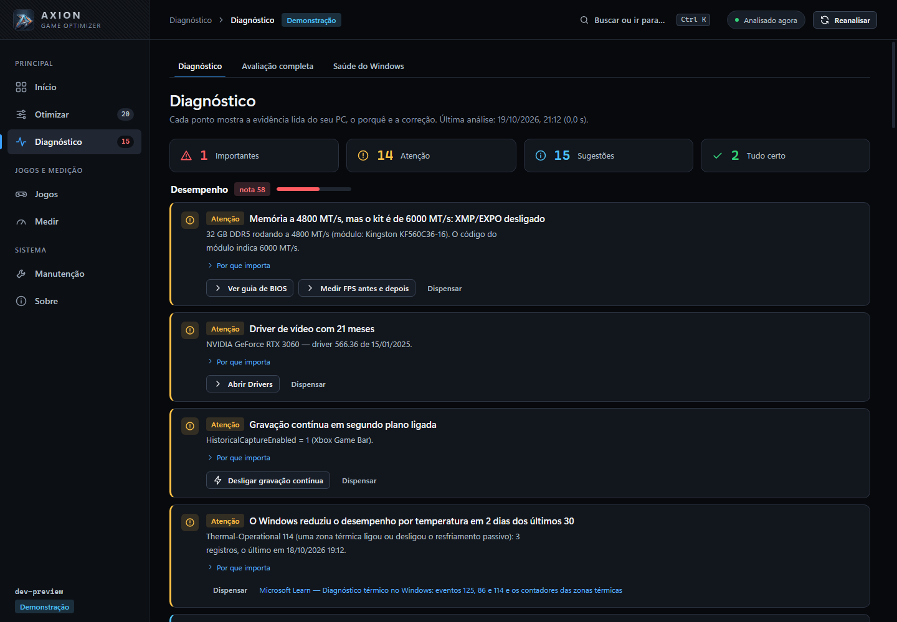
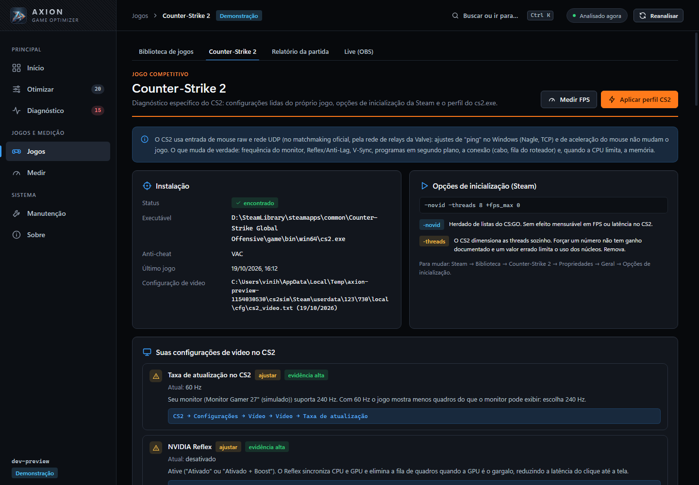
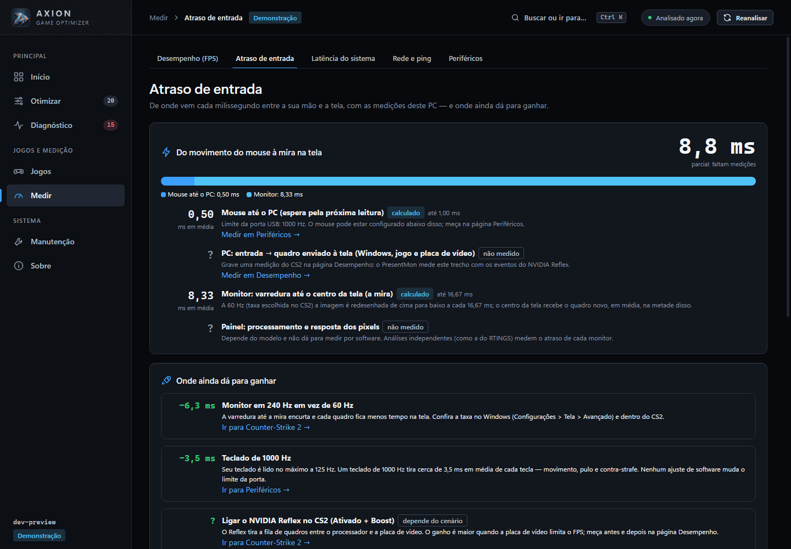
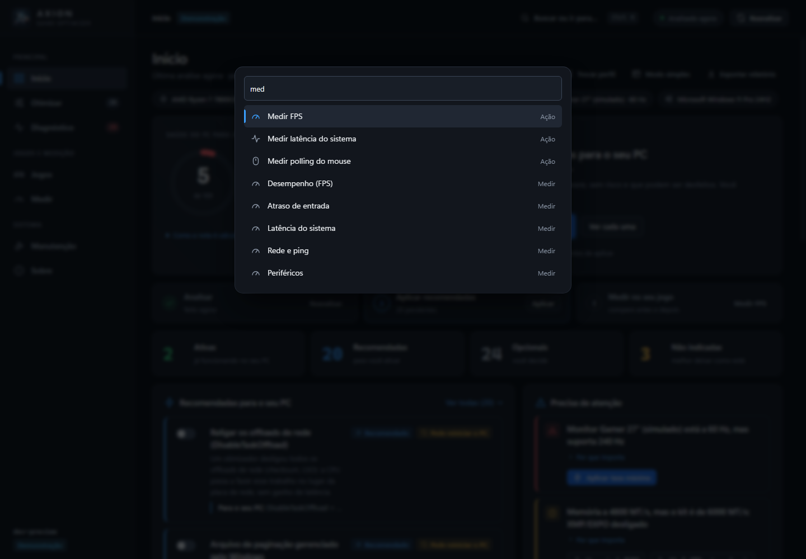
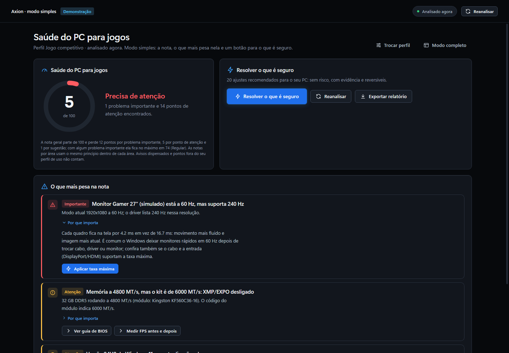
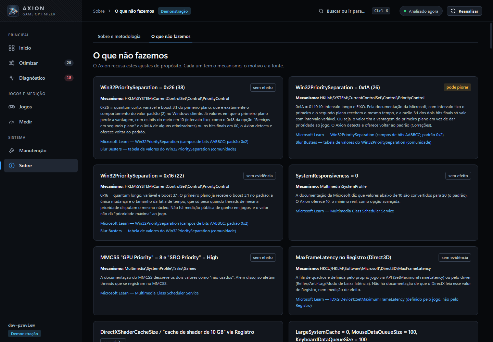

<p align="center"></p>

<p align="center">
  <b>Otimização de Windows para jogos, com evidência e desfazer exato.</b><br>
  Analisa o seu PC, mostra o que atrapalha nos jogos e só recomenda o que tem benefício documentado para o seu hardware.
</p>

<p align="center">
  <a href="https://github.com/vinihammoud-create/axion-optimizer/actions/workflows/ci.yml"></a>
  
  
  <a href="LICENSE"></a>
  
  
</p>

<p align="center"></p>

> **Estado:** versão de teste (0.9.1), ainda sem assinatura digital: veja [Como usar](#como-usar). Funciona no Windows 10 e no 11, de 64 bits.

## Por que o Axion é diferente

- **Só recomenda o que tem fonte.** Cada ajuste mostra o que faz, o nível de evidência, o risco e os links de onde a informação veio. Ajuste sem evidência de ganho não entra.
- **Tudo tem desfazer exato.**
  - Antes de gravar qualquer coisa, o Axion guarda o valor anterior num histórico assinado, escrito no disco antes da mudança.
  - Se o PC desligar no meio, o que ficou pela metade aparece como interrompido e pode ser desfeito.
  - Nos lotes, o Axion também cria um ponto de restauração do Windows.
- **Sem driver de kernel e sem PowerShell.** Só registro, WMI, a API do Windows e programas do próprio Windows. Nada de scripts nem de arquivos de lote.
- **Mede antes e depois.**
  - O FPS é medido com o [PresentMon](https://github.com/GameTechDev/PresentMon), da Intel.
  - A "Prova no seu PC" grava medições antes e depois de um ajuste de energia. O ajuste só fica se melhorar pelo critério do Axion (teste estatístico e diferença mínima de 1%); senão, ele é desfeito sozinho.
- **O que ele recusa é público.** A página "O que não fazemos" lista ajustes populares que o Axion deixa de fora de propósito, cada um com o mecanismo, o motivo e a fonte.
- **Feito para o seu uso.**
  - O perfil escolhido (jogo competitivo, jogo e live, trabalho, criação ou programação) define o que conta na nota e o que entra no 1 clique.
  - Notebook é tratado como notebook: na bateria, nada que gaste energia é recomendado.

## O que ele faz

### Otimizar
Catálogo por categoria, com a recomendação calculada para o seu PC.
- O 1 clique aplica o plano Recomendado, o Completo ou o Perfil Counter-Strike 2.
- Você revisa a lista antes e pode desmarcar qualquer item.
- Tudo fica no Histórico, com desfazer.

O Axion também detecta e oferece desfazer o que outros otimizadores deixaram para trás:
- HPET forçado e tick do sistema;
- ajustes de TCP e offloads da placa de rede;
- modo de teste de drivers, DEP e UAC desligados;
- TDR da GPU e arquivo de paginação;
- serviços essenciais desativados e Windows Update bloqueado.

<p align="center"></p>

### Diagnóstico
Cada alerta mostra o que foi lido do seu PC, por que importa e como resolver. Entre os pontos verificados:
- monitor abaixo da frequência máxima;
- memória sem XMP/EXPO;
- saúde, temperatura e espaço do SSD;
- driver de vídeo e Resizable BAR;
- requisitos dos anti-cheats (TPM, Secure Boot, VBS);
- microcódigo dos Intel de 13ª e 14ª geração e versão da BIOS;
- estabilidade: erros de hardware, telas azuis com orientação por código, desligamentos inesperados e reinícios do driver de vídeo.

<p align="center"></p>

### Temperatura do processador, sem driver (novo na 0.9.1)
O Axion usa só o que o Windows documenta e informa:
- desligamento por temperatura crítica;
- throttling térmico confirmado pelo Windows;
- limite do firmware na velocidade do processador;
- zonas térmicas da placa;
- limite de frequência por temperatura, também amostrado durante as medições de FPS e as partidas.

Cada aviso vem com o que fazer, com texto diferente para notebook e para desktop. O Axion não lê a temperatura do núcleo do processador, porque isso exige um driver, e ele não instala driver.

### Jogos e Counter-Strike 2
- **Biblioteca:** jogos da Steam, Epic, Riot, Ubisoft, Battle.net, EA e Xbox, com perfil por jogo.
- **CS2:**
  - as configurações de vídeo lidas do próprio jogo;
  - as opções de inicialização da Steam;
  - um preset competitivo opcional, com cópia do arquivo e desfazer.
- **Relatório da partida:** opcional, gerado ao fechar o jogo.

<p align="center"></p>

### Medir
- **FPS:** 1% e 0,1% low, engasgos e o que limitou cada quadro.
- **Atraso de entrada:** do mouse à tela.
- **Latência do sistema:** DPC/ISR.
- **Rede e ping:** cada trecho até os relays da Valve, com oscilação, perda, bufferbloat e DNS. Troca de DNS com desfazer.
- **Periféricos:** polling real do mouse e como cada dispositivo está ligado.

<p align="center"></p>

### Manutenção
- **Limpeza:**
  - mede antes de apagar;
  - arquivos em uso ou das últimas 24 h ficam;
  - caches que aceleram jogos não entram.
- **Saúde do Windows:** drivers de kernel vulneráveis e, quando você pede, reparo com DISM e SFC.
- **Drivers:**
  - as atualizações que o Windows Update oferece;
  - o driver NVIDIA comparado com o mais novo do site, com a assinatura do instalador conferida;
  - pacotes de vídeo antigos que podem ser excluídos.
- **Inicialização e processos:** o que abre com o Windows, com desfazer.
- **Programas:** desinstalar com as sobras indo para a quarentena por 30 dias.
- **Instalar programas** pelo winget, depois de formatar.
- **Guia de BIOS** da sua placa-mãe.

### Fácil de usar
- **Ctrl+K:** leva a qualquer página, ação ou otimização.
- **Modo simples:** a nota, o que mais pesa e um botão para resolver o que é seguro.

<p align="center">
  
  
</p>

## Seguro para jogos competitivos

O Axion segue uma regra em todo o código: nada de driver de kernel, nada de abrir o processo do jogo para escrita, nada de injeção e nada de overlay dentro do jogo. Só a API do Windows em modo usuário.

Ele não interage com anti-cheats: só identifica quais estão instalados, lendo o registro. Também não suspende nem rebaixa programas durante a partida e não muda afinidade nem prioridade de E/S.

O único arquivo de jogo que ele altera é o `cs2_video.txt`, e só se você ligar o preset opcional do CS2, com cópia e desfazer.

Isso reduz o risco, mas o Axion **não promete** que nenhum anti-cheat vá aceitá-lo: as regras são deles e mudam. O relatório da partida, por exemplo, foi testado só no simulador, e não com Vanguard, EAC ou BattlEye.

<p align="center"></p>

## Como usar

1. **Baixe** o `.zip` mais recente em [Releases](https://github.com/vinihammoud-create/axion-optimizer/releases).
2. **Extraia** o ZIP numa pasta (por exemplo, `Documentos\Axion`) e mantenha os arquivos juntos:
   - `WebView2Loader.dll` abre a janela do Axion;
   - `PresentMon-2.6.0-x64.exe` mede o FPS.
3. **Abra o `Axion.exe`** e aceite o pedido de administrador. A análise só lê; a permissão serve para aplicar otimizações.
4. **Responda o perfil de uso** e espere a análise, que leva alguns segundos.
5. **Aplique o recomendado:** no Início, use "Aplicar as recomendadas", revise a lista e aplique.

**Aviso do SmartScreen.** O Axion ainda não tem assinatura digital, então o Windows pode mostrar "O Windows protegeu o computador".
- Antes de liberar, confira o SHA-256 do `Axion.exe` com o `SHA256SUMS.txt` do pacote. No PowerShell: `Get-FileHash Axion.exe`.
- Depois, clique em "Mais informações › Executar assim mesmo".
- Um alarme falso do antivírus pode ser enviado à Microsoft em <https://www.microsoft.com/wdsi/filesubmission>.
- Nunca desligue o antivírus.

O `LEIA-ME.txt` do pacote explica o caso do "Controle inteligente de aplicativos" do Windows 11.

## Perguntas frequentes

**Posso desfazer tudo?** Sim. Em Otimizar › Histórico dá para desfazer um item, um lote ou tudo, e o Axion confere cada valor depois. Se outro programa mudou o item depois, ele avisa antes de sobrescrever.

**Funciona em notebook?** Sim.
- O Axion detecta a bateria e não recomenda nada que gaste energia.
- O "Modo de energia" só é aplicado e desfeito na tomada.
- Os alertas que só fazem sentido em desktop não aparecem.

**Por que ele não faz o ajuste X que vi num vídeo?** Provavelmente está em "O que não fazemos", com o motivo e a fonte. Se não estiver, abra uma issue com a fonte.

**O Axion envia dados?** Não há telemetria. Ele só usa a internet nos testes de rede, na comparação do driver NVIDIA com o site da NVIDIA e quando você instala programas pelo winget. O relatório exportado é anônimo por padrão: nome do PC, contas, endereços de rede e números de série são trocados por marcadores.

## Compilar e contribuir

Requisitos: Windows, Go 1.24 ou mais novo e Windows PowerShell. As dependências ficam em `third_party/`, então a compilação não precisa de internet.

```powershell
.\build\build.ps1          # testes, executável e pacote .zip
.\build\dev\preview.ps1    # a interface sobre um PC simulado, sem tocar no seu sistema
```

O PowerShell aqui é só da compilação; o Axion em si nunca roda PowerShell.

- [`CONTRIBUTING.md`](CONTRIBUTING.md): como propor mudanças.
- [`REVISAO-DE-MUDANCAS.md`](REVISAO-DE-MUDANCAS.md): a regra de evidência para ajustes novos.
- [`docs/COMO-MODIFICAR.md`](docs/COMO-MODIFICAR.md): onde fica cada coisa.
- [`SECURITY.md`](SECURITY.md): para avisar falhas de segurança.
- [`CHANGELOG.md`](CHANGELOG.md): o que mudou em cada versão.

As imagens desta página vêm do modo demonstração, que roda a interface real sobre um PC simulado: os dados não são de uma máquina real.

## Licença e créditos

**Licença:** [MIT](LICENSE).

**Componentes de terceiros:** listados em [`build/THIRD-PARTY-NOTICES.txt`](build/THIRD-PARTY-NOTICES.txt):
- [go-webview2](https://github.com/jchv/go-webview2) e o carregador do Microsoft Edge WebView2;
- [PresentMon](https://github.com/GameTechDev/PresentMon), da Intel;
- [go-ole](https://github.com/go-ole/go-ole);
- [golang.org/x/sys](https://pkg.go.dev/golang.org/x/sys).
