<p align="center">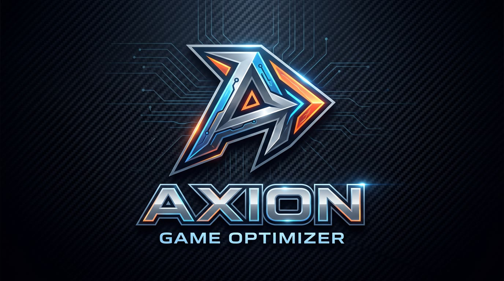</p>

<h3 align="center">O otimizador de Windows para jogos que mostra a fonte de cada ajuste e deixa desfazer cada um.</h3>

<p align="center">
  Analisa o seu PC, aponta o que atrapalha nos jogos e só recomenda o que tem benefício documentado para o seu hardware.<br>
  Sem driver, sem injeção no jogo, sem telemetria. Cada otimização guarda o valor anterior e volta ao que era com um clique.
</p>

<p align="center">
  
  
  <a href="LICENSE"></a>
  
  
  <a href="https://github.com/vinihammoud-create/axion-optimizer/actions/workflows/ci.yml"></a>
</p>

<p align="center">
  <a href="https://github.com/vinihammoud-create/axion-optimizer/releases/latest"></a>
  <br>
  <sub><a href="#como-instalar">Como instalar</a> · <a href="#primeiros-passos">Primeiros passos</a> · <a href="#seguran%C3%A7a-e-privacidade">Segurança e privacidade</a> · <a href="#perguntas-frequentes">Perguntas frequentes</a></sub>
</p>

<p align="center">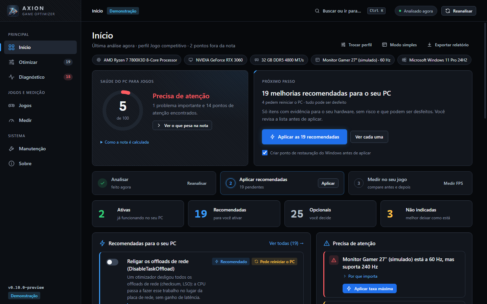</p>

<p align="center"><sub>Todas as imagens desta página são da interface real rodando sobre o PC simulado do projeto (modo demonstração, por isso o selo "Demonstração"). Os números não são de uma máquina real.</sub></p>

## Por que o Axion é diferente

| | |
|---|---|
| **Fonte para cada ajuste** | Cada otimização mostra o que muda no Windows, o nível de evidência, o risco e os links de onde a informação veio. Sem fonte aberta e lida, o ajuste não entra. |
| **Desfazer exato** | Antes de aplicar uma otimização, o Axion guarda o valor anterior (inclusive "não existia") num histórico assinado. Desfazer volta exatamente a ele e confere relendo. Nos lotes, a criação de um ponto de restauração do Windows já vem marcada. |
| **Sem driver, sem injeção, sem telemetria** | Não instala driver de kernel, não injeta nada no jogo nem desenha sobre ele, não roda PowerShell nem arquivos de lote e não envia dados. Usa só registro, WMI, a API do Windows e ferramentas do próprio Windows. |
| **Mede antes e depois** | FPS, 1% e 0,1% low e engasgos pelo PresentMon, da Intel. A "Prova no seu PC" só mantém um ajuste se ele melhorar pelo critério do Axion; se não melhorar, desfaz sozinho. |
| **O que ele recusa é público** | A página "O que não fazemos" lista ajustes populares que ficam de fora de propósito, cada um com o mecanismo, o motivo e a fonte. |
| **Para quem joga e para quem não joga** | Perfis de jogo competitivo, jogo + live, trabalho, criação e programação. O perfil decide o que conta na nota e o que entra no 1 clique; nos perfis que não jogam, os atalhos de FPS e do CS2 saem do caminho. Notebook é tratado como notebook: na bateria, o Axion avisa antes de medir e não aplica o modo de energia. |
| **Simples ou Avançado** | O seletor no topo escolhe entre uma tela só (a nota, o que mais pesa e as recomendadas sem risco) e a interface completa. As explicações longas ficam atrás de um botão "?", e abrem só quando você pede. |

## O que ele faz

### Diagnóstico com evidência

O Axion lê o PC e mostra cada ponto com o que foi lido, por que importa e como resolver. Leitura que falhou aparece como "não lido", nunca como "tudo certo".

- Monitor abaixo da frequência máxima, memória sem XMP/EXPO, canal de memória.
- SSD (desgaste, temperatura e espaço), driver de vídeo, PCIe e Resizable BAR.
- Requisitos dos anti-cheats (TPM, Secure Boot, VBS), microcódigo dos Intel de 13ª e 14ª geração, versão da BIOS.
- Estabilidade: erros de hardware, telas azuis com orientação por código, desligamentos inesperados, reinícios do driver de vídeo.
- Temperatura do processador pelo que o Windows informa sem driver: desligamento por temperatura crítica, throttling confirmado e limite de frequência.

Além da gravidade, cada achado diz quanto a leitura sustenta a conclusão:

| Rótulo | Quando aparece |
|---|---|
| **Problema confirmado** | Uma leitura direta mostra o problema: um valor do registro, do WMI ou da API do Windows, um número comparado com um limite publicado, um registro do Visualizador de Eventos. |
| **Possível problema** | A conclusão depende de uma inferência, de uma correlação ou do critério do Axion. É também o padrão: na dúvida, a regra não afirma mais do que leu. |
| **Informação insuficiente** | O achado existe para dizer que algo não pôde ser lido. Aparece em tom neutro, nunca verde. |
| **Condição normal** | Não há nada a corrigir. |

<p align="center">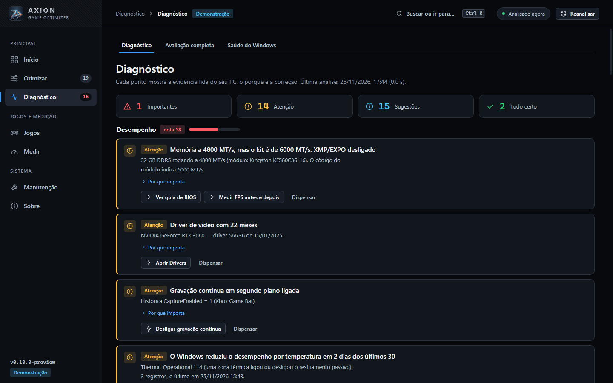</p>

A **Avaliação completa** junta tudo num botão e dá três notas: configuração, capacidade do hardware para o seu uso e medição.

<p align="center">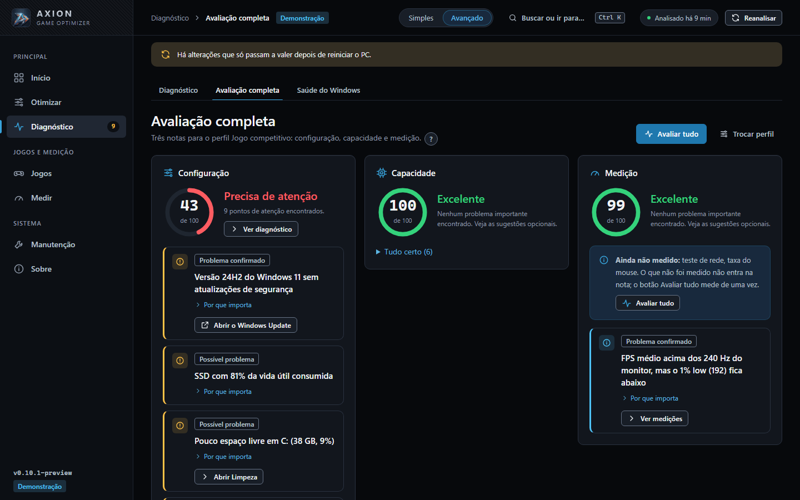</p>

### Otimizar, item por item ou em 1 clique

O catálogo é dividido por categoria, com a recomendação calculada para o seu PC. O 1 clique aplica o plano Recomendado, o Completo ou o Perfil Counter-Strike 2, e você revisa a lista antes.

Cada linha mostra quatro sinais sem abrir nada:

1. **Estado:** Ativo, Recomendado, Opcional, Não indicado, Bloqueado neste PC ou Não se aplica.
2. **Risco:** sempre visível, inclusive "risco seguro".
3. **Origem:** "Aplicado pelo Axion", "Já estava assim no Windows" ou "Não aplicado".
4. **Desfazer:** um botão na própria linha, quando foi o Axion que aplicou. Faz o mesmo que o Desfazer do Histórico.

**Seleção em arquivo:** "Exportar seleção" salva a lista do que o Axion aplicou (só os identificadores, sem dados do PC); "Importar seleção" abre o plano com esses itens neste ou em outro PC, com as mesmas regras do 1 clique, e nada é aplicado sem você confirmar. O que fica de fora aparece com o motivo.

<p align="center">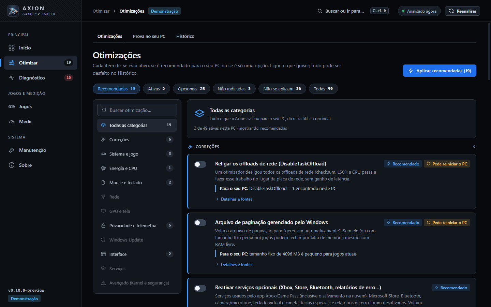</p>

Abra qualquer item para ver **como funciona, a evidência, o risco, o valor exato que vai mudar (e o atual) e as fontes**:

<p align="center">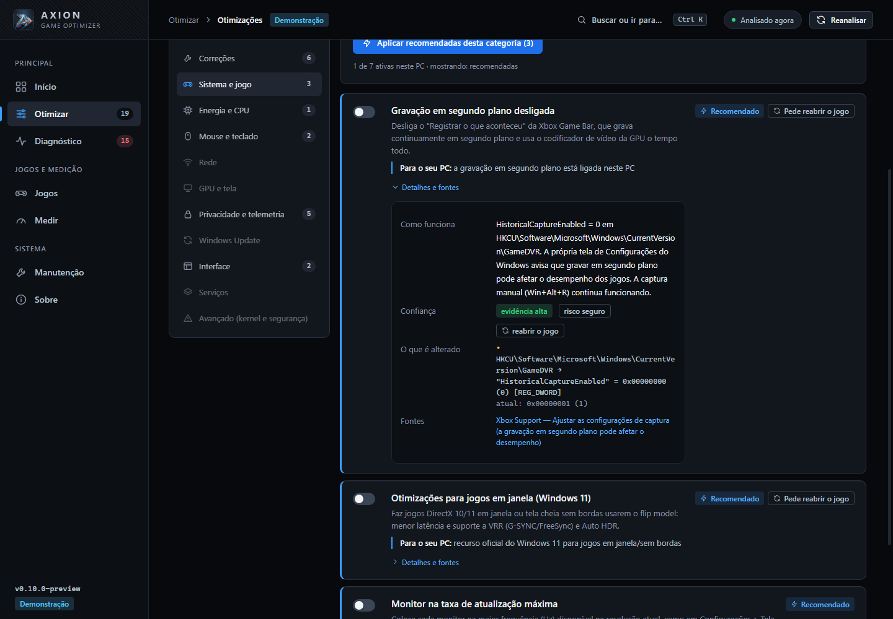</p>

Depois de aplicar, a linha diz de onde veio cada item ativo e oferece o Desfazer ali mesmo. O "?" ao lado da frase do topo abre o resto da explicação logo abaixo:

<p align="center">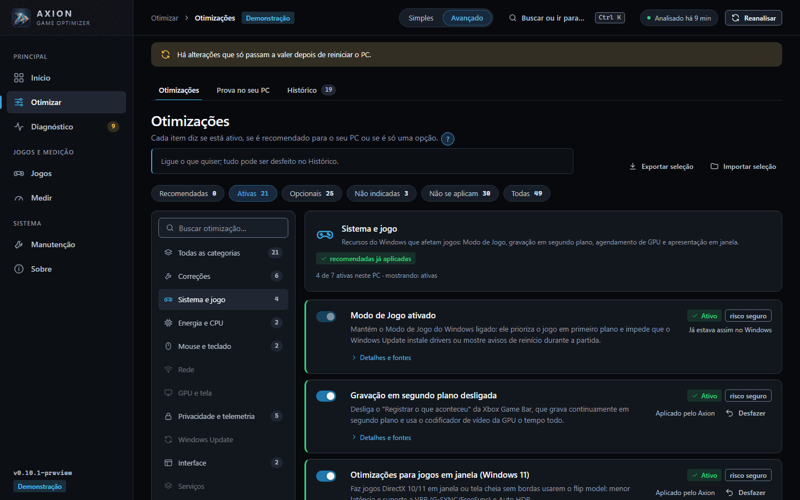</p>

| Antes de aplicar, a lista completa | Frequência do monitor: você confirma |
|---|---|
| 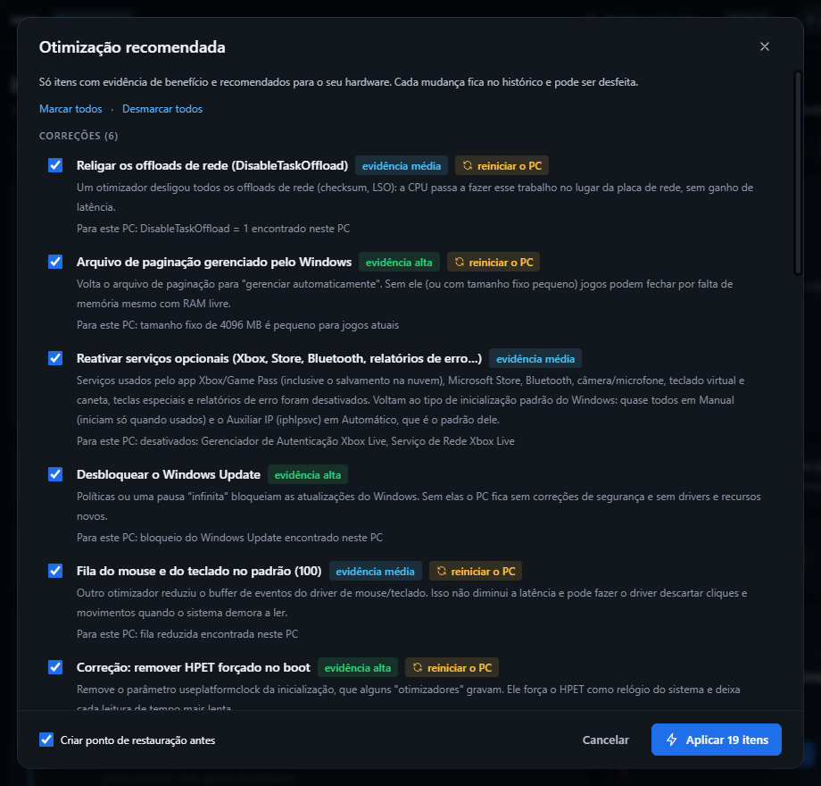 | 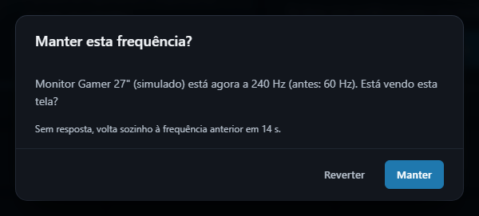 |
| Dá para desmarcar qualquer item. O ponto de restauração do Windows vem marcado. | O monitor troca para a frequência máxima e o Axion pergunta se você está vendo a tela. Sem resposta em 15 segundos, volta sozinho à anterior e nada fica gravado. |

O Axion também encontra e oferece desfazer o que **outros otimizadores deixaram para trás**: HPET forçado e tick do sistema, ajustes de TCP e offloads da placa de rede, modo de teste de drivers, DEP e UAC desligados, TDR da GPU, arquivo de paginação, serviços essenciais desativados e Windows Update bloqueado.

**PC de empresa ou escola:** a análise lê se o PC faz parte de um domínio e se está inscrito num gerenciamento de dispositivos (MDM, como o Intune), sem guardar o nome do domínio. Num PC gerenciado, "Desbloquear o Windows Update" passa a "não recomendado" e sai do 1 clique, porque as políticas de atualização podem ser da organização e a Política de Grupo pode gravá-las de novo; o motivo diz para falar com o TI. Se a leitura falhar, o item também fica fora do 1 clique. Ele continua em Otimizações, com desfazer, para quem quiser aplicar mesmo assim.

### Medir

| | |
|---|---|
| **Desempenho (FPS)** | FPS médio, 1% e 0,1% low, engasgos e o que limitou cada quadro (CPU, GPU ou limite de FPS), com comparação antes × depois. |
| **Atraso de entrada** | Do movimento do mouse à mira na tela, com o que foi medido no seu PC e onde ainda dá para ganhar. |
| **Latência do sistema** | Rotinas de driver (DPC/ISR) que seguram o processador. |
| **Rede e ping** | Cada trecho até os relays da Valve, oscilação, perda, bufferbloat e DNS. Troca de DNS com desfazer. |
| **Periféricos** | Polling real do mouse e como cada mouse e teclado está ligado (porta USB, hub, controlador). |
| **Prova no seu PC** | 3 medições antes, o ajuste, 3 depois. Só fica se melhorar pelo critério do Axion. |

<p align="center">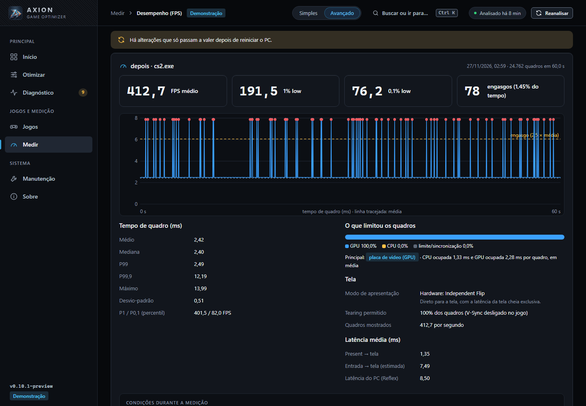</p>

| Atraso de entrada | Prova no seu PC |
|---|---|
| 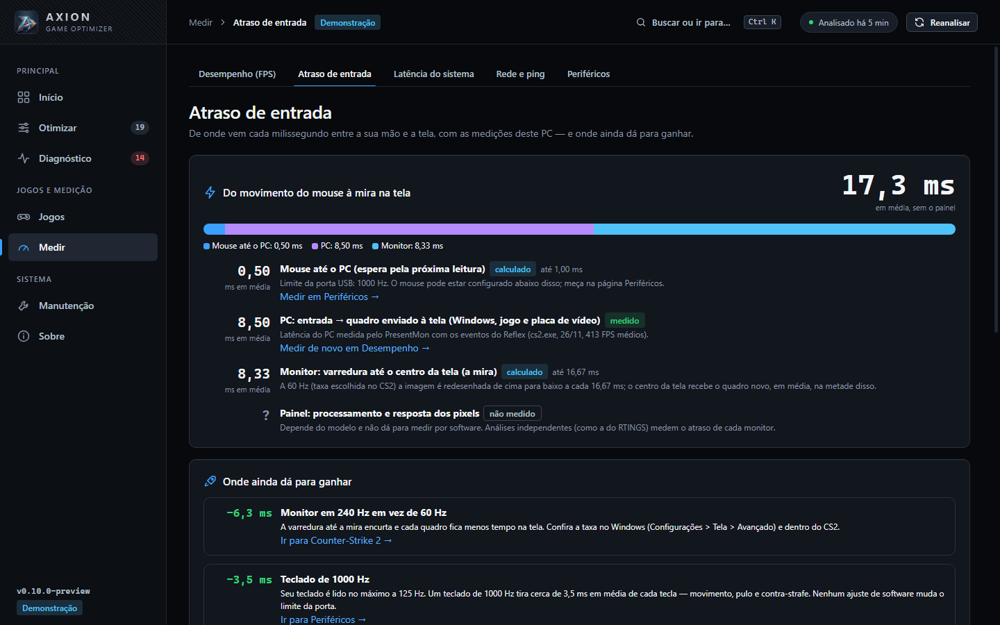 | 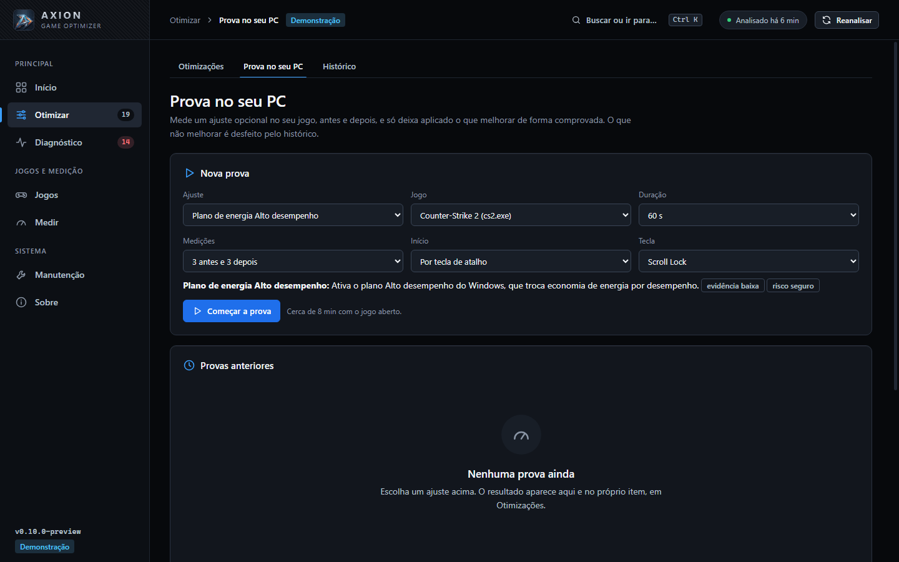 |

### Jogos e Counter-Strike 2

- **Biblioteca:** jogos da Steam, Epic, Riot, Ubisoft, Battle.net, EA e Xbox, com perfil por jogo no Windows (prioridade, placa de vídeo, tela cheia).
- **CS2:** as configurações de vídeo lidas do próprio jogo, as opções de inicialização da Steam e um preset competitivo opcional, com cópia do arquivo e desfazer.
- **Relatório da partida:** opcional, gerado ao fechar o jogo, sem tocar nele.

| Biblioteca de jogos | Counter-Strike 2 |
|---|---|
| 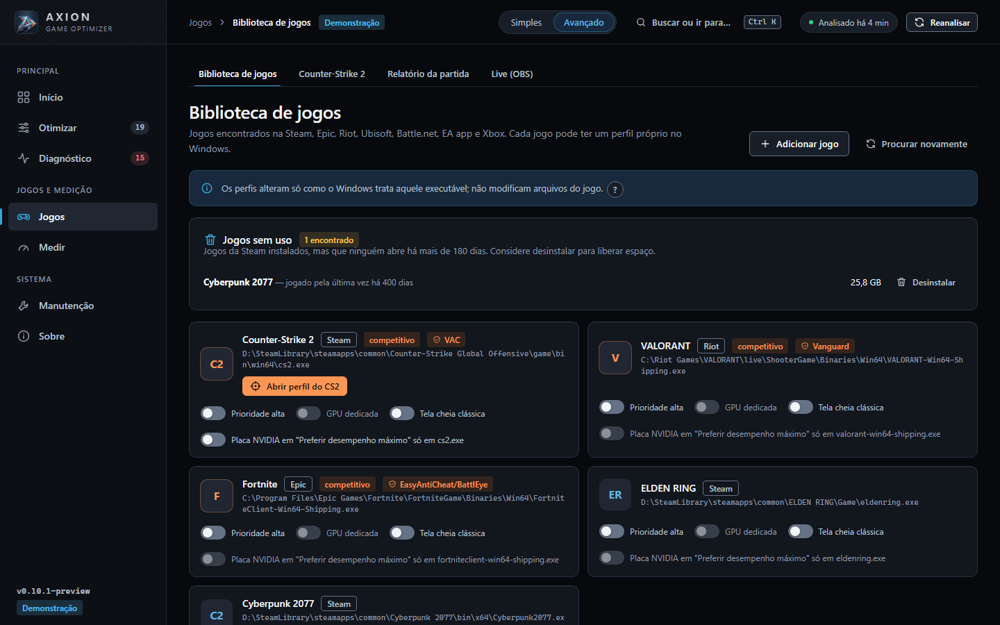 | 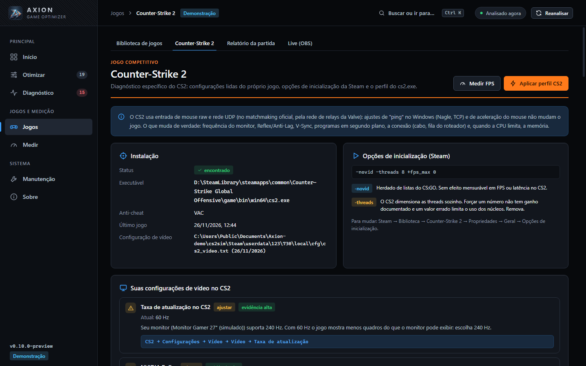 |

### Saúde do Windows e manutenção

- **Saúde do Windows:** antivírus, atualizações, discos, bateria e inicialização numa página; drivers de kernel vulneráveis; reparo de arquivos com o DISM e o SFC do Windows, só quando você pede.
- **Limpeza:** mede antes de apagar; arquivos em uso ou das últimas 24 h ficam; caches que aceleram jogos não entram.
- **Drivers:** as atualizações do Windows Update, o driver NVIDIA comparado com o do site, pacotes de vídeo antigos.
- **Inicialização e programas:** o que abre com o Windows (com desfazer) e desinstalação com as sobras na quarentena.
- **Instalar programas** pelo winget depois de formatar, e **guia de BIOS** da sua placa-mãe.

<p align="center">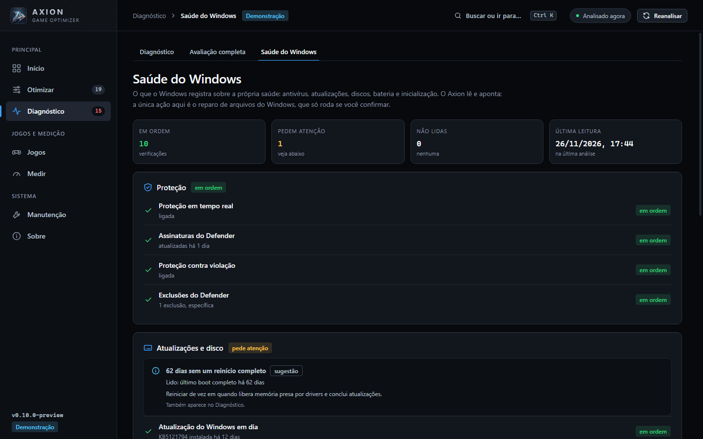</p>

### Histórico: tudo volta ao que era

Cada mudança aparece com a hora, o valor anterior e um botão **Desfazer**. Dá para desfazer um item, um lote ou tudo; se outro programa mexeu no item depois, o Axion avisa antes de sobrescrever. O mesmo Desfazer aparece na linha de cada otimização que o Axion aplicou.

| Histórico com os valores anteriores | Resultado do "Desfazer tudo" |
|---|---|
| 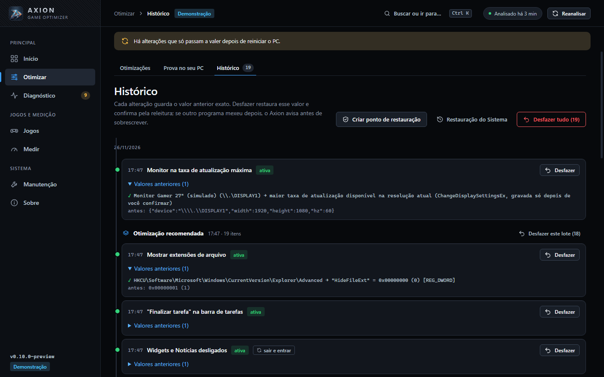 | 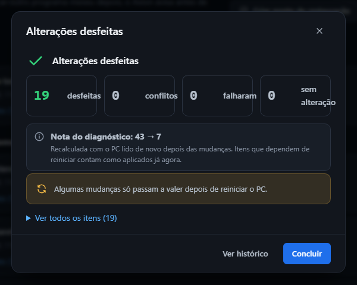 |

### Fácil para quem não quer mexer em nada

O seletor **Simples | Avançado** fica sempre na barra superior, e a escolha fica guardada. Instalação nova começa no Simples; quem já usava o Axion continua no modo em que estava. Trocar de modo não aplica nem desfaz nada.

- **Simples** é uma tela só: a nota, o que mais pesa nela, "Aplicar recomendadas" (só itens sem risco, os mesmos do 1 clique, com a lista para conferir antes) e "Desfazer mudanças", que abre o Histórico sem sair do modo Simples.
- **Avançado** é a interface completa: todas as páginas, todas as otimizações e o que cada uma altera no Windows. As imagens desta página, menos a do modo Simples, são do Avançado.
- **Ajuda "?":** as explicações longas viraram uma frase na tela e um botão "?" ao lado. O resto abre logo abaixo com um clique (ou Enter ou Espaço) e fecha com Esc. Os diálogos de aplicar e desfazer, as mensagens de erro e o detalhe de cada achado e de cada otimização continuam inteiros na tela.

| Modo Simples | Busca Ctrl+K |
|---|---|
| 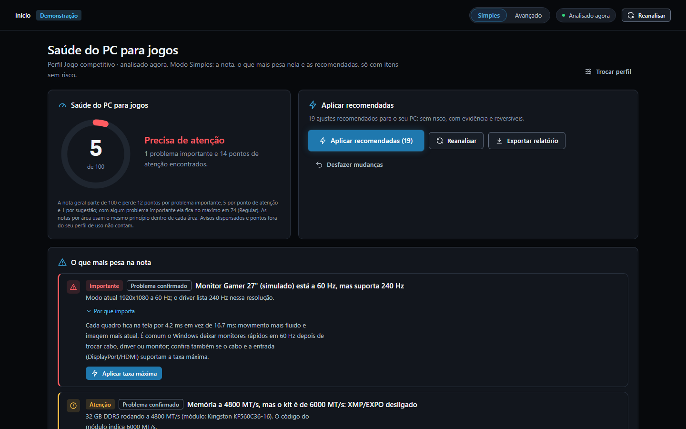 | 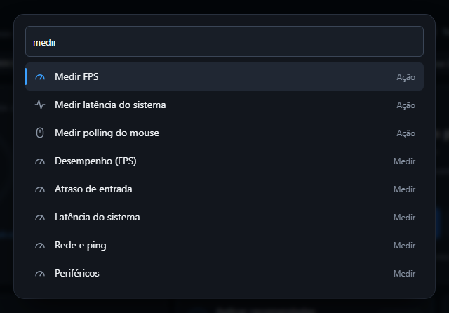 |
| A nota, o que mais pesa nela, "Aplicar recomendadas" e "Desfazer mudanças". | Digite o nome de uma página, de uma ação ("medir FPS") ou de uma otimização. Disponível no modo Avançado. |

### O que não fazemos

Ajustes famosos que o Axion recusa de propósito, com o mecanismo, o motivo e a fonte de cada um: "limpar a RAM", apagar cache de shaders, prioridades e afinidades forçadas, valores de registro sem efeito documentado e outros.

<p align="center">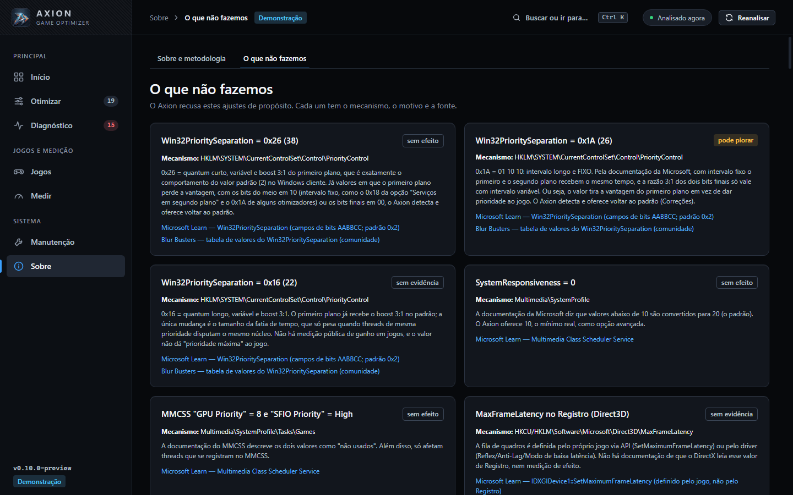</p>

## Como instalar

Na [página da versão mais recente](https://github.com/vinihammoud-create/axion-optimizer/releases/latest) há dois jeitos de baixar. Os dois trazem o mesmo `Axion.exe`.

| | Para quem | Como |
|---|---|---|
| **Instalador** `Axion-0.10.1-setup.exe` | Recomendado para a maioria | Instala em Arquivos de Programas, cria o atalho no menu Iniciar e aparece em Configurações > Aplicativos, de onde se desinstala. Antes de instalar, mostra o que o Axion faz e a licença. |
| **ZIP portátil** `Axion-0.10.1-win64.zip` | Quem não quer instalar nada | Extraia numa pasta e abra o `Axion.exe`, mantendo os arquivos juntos. Para remover, apague a pasta. |

Nos dois casos, os dados ficam em `C:\ProgramData\Axion`.

### Requisitos

- Windows 10 ou Windows 11, de 64 bits. No Windows 10 anterior à versão 2004, a troca de DNS não está disponível.
- Uma conta de administrador: o Axion pede permissão sempre que abre, porque as otimizações mudam configurações do Windows. A análise só lê.
- Microsoft Edge WebView2 Runtime, que já vem no Windows 11 e na maioria dos Windows 10. Sem ele, o Axion abre no navegador; o instalador avisa e leva à [página oficial da Microsoft](https://developer.microsoft.com/microsoft-edge/webview2/). A janela própria é o modo recomendado: no navegador, a chave de acesso à interface passa pelo navegador padrão e pelas extensões dele; na janela própria, fica só dentro dela.

### "O Windows protegeu o computador"

O Axion ainda **não tem assinatura digital** (o projeto vai pedir a assinatura gratuita para programas de código aberto, veja [Code signing policy](#code-signing-policy)). Por isso o SmartScreen pode mostrar esse aviso azul, e o antivírus pode desconfiar de um arquivo novo que pouca gente baixou. É o aviso normal para programas sem assinatura, não um sinal de vírus, mas vale conferir antes:

1. **Confira o SHA-256** do arquivo baixado com o valor do `SHA256SUMS.txt` da mesma página da versão. Os dois comandos abaixo são do próprio Windows; use o que preferir:

   ```powershell
   Get-FileHash .\Axion-0.10.1-setup.exe -Algorithm SHA256
   ```

   ```bat
   certutil -hashfile Axion-0.10.1-setup.exe SHA256
   ```

   Os 64 caracteres precisam ser iguais (maiúsculas e minúsculas não importam). Se forem diferentes, não abra o arquivo e baixe de novo pela página oficial.
2. Com o hash conferido, clique em **Mais informações** e depois em **Executar assim mesmo**. Isso vale só para este arquivo; as proteções do Windows continuam ligadas.

Não desligue o antivírus nem o SmartScreen. Se o antivírus acusar um alarme falso, você pode enviar o arquivo para análise da Microsoft em <https://www.microsoft.com/wdsi/filesubmission>. Em PCs com o Controle Inteligente de Aplicativos do Windows 11 ligado, programas sem assinatura não abrem; isso só muda quando o Axion tiver assinatura. Esse controle protege o PC inteiro: não o desligue por causa do Axion.

## Primeiros passos

<p align="center">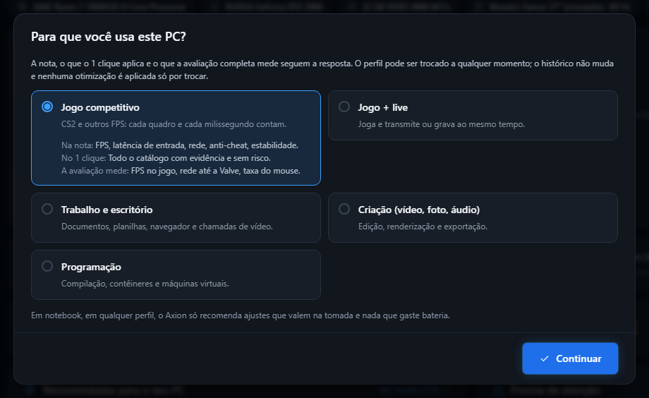</p>

1. **Escolha o seu perfil.** Na primeira abertura o Axion pergunta para que você usa o PC e faz a análise, que leva alguns segundos. A análise só lê. Ele abre no modo Simples; para ver todas as páginas, escolha **Avançado** no topo.
2. **Leia o diagnóstico.** O Início mostra a nota, o que mais pesa nela e o próximo passo. Cada ponto diz se o problema é confirmado ou possível, e "Por que importa" explica o motivo.
3. **Aplique as recomendadas.** "Aplicar as recomendadas" abre a lista: revise, desmarque o que quiser e aplique. Os itens que só valem depois de reiniciar vêm sinalizados.
4. **Meça antes e depois.** Em Medir > Desempenho, grave com o rótulo "antes", aplique, e grave com "depois", sempre no mesmo cenário do jogo.
5. **Desfaça o que não quiser.** Em Otimizar > Histórico, um item, um lote ou tudo; ou no botão Desfazer da própria linha da otimização. No modo Simples, "Desfazer mudanças" abre o Histórico.

<p align="center">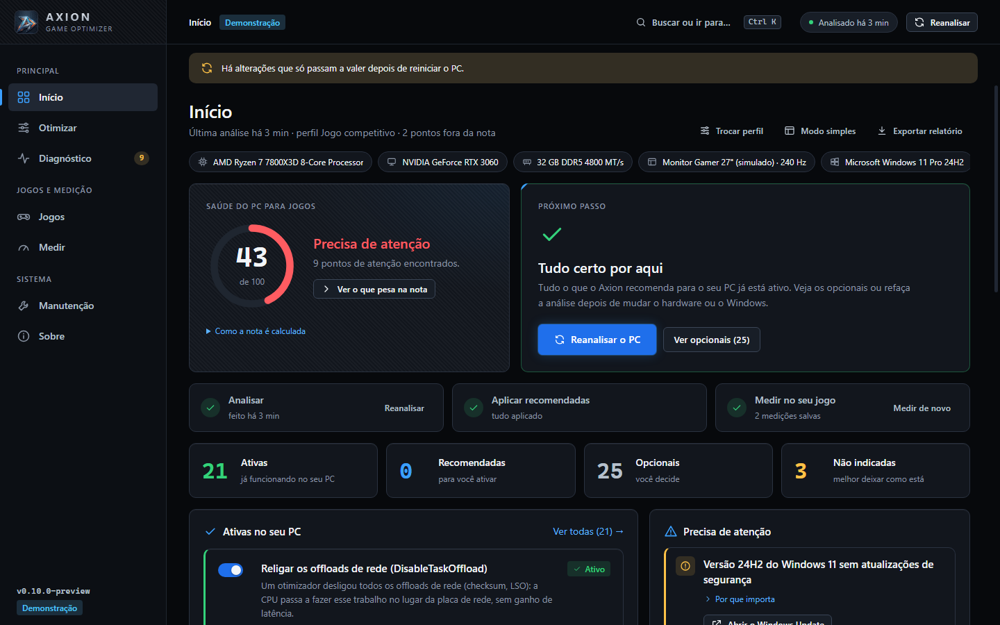</p>

## Como desfazer e como desinstalar

- **Desfazer:** Otimizar > Histórico > **Desfazer tudo** (ou um item, ou um lote). Cada otimização que o Axion aplicou também tem um botão Desfazer na própria linha. No modo Simples, o botão "Desfazer mudanças" abre o Histórico sem sair do Simples. A Restauração do Sistema do Windows também serve, já que o Axion cria um ponto antes dos lotes.
- **Desinstalar não desfaz os ajustes.** O que o Axion mudou no Windows continua mudado. Para voltar tudo ao que era, use **Desfazer tudo antes de desinstalar**.
- **O desinstalador avisa:** ele lê o histórico e, se ainda houver alterações ativas, diz quantas e recomenda desfazer antes. Se não conseguir ler o histórico, diz isso em vez de seguir como se não houvesse nada.
- **O histórico fica guardado, a menos que você peça.** O desinstalador remove o programa, os atalhos e o cache da janela. A pasta de dados (`C:\ProgramData\Axion`, com o histórico para desfazer, a quarentena e as medições) só é apagada se você responder Sim; o padrão é manter, e um Axion instalado de novo continua podendo desfazer.
- **Versão ZIP:** desfaça tudo no Histórico e apague a pasta do programa.
- **O que não tem desfazer:** as ações de manutenção que não são otimizações, como a limpeza de temporários, o reparo de arquivos do Windows (DISM e SFC) e a exclusão de pacotes de driver de vídeo antigos. Elas só rodam quando você confirma.

## Segurança e privacidade

**Por que ele roda como administrador.** As otimizações gravam configurações do Windows que só um administrador pode mudar (registro do sistema, serviços, plano de energia). A análise e o diagnóstico só leem; nada muda sem você confirmar.

**O que ele nunca faz:**

- instalar ou carregar driver de kernel;
- abrir o processo do jogo para escrita, injetar código ou desenhar sobre o jogo;
- rodar PowerShell ou arquivos de lote;
- alterar a BIOS ou gravar firmware pelo Windows;
- mexer em arquivos de jogos (a única exceção é o `cs2_video.txt`, e só pelo preset opcional do CS2, com cópia e desfazer);
- enviar dados: não há telemetria.

**Onde ficam os dados.** Tudo fica em `C:\ProgramData\Axion`: o histórico com os valores anteriores, a quarentena, as medições, as configurações e o registro do programa. Só administradores alteram essa pasta, e o histórico e a quarentena são assinados com uma chave que só administradores leem. A interface roda num servidor local (`127.0.0.1`) protegido por um token que muda a cada execução.

**Rede só quando você pede.** O Axion usa a internet apenas quando você clica:

| Ação | Fala com |
|---|---|
| Teste de rede | Lista pública de relays da Valve (Steam), Cloudflare para o teste de carga, os servidores de DNS testados e os endereços que recebem ping |
| Procurar atualizações de driver | Windows Update (Microsoft) e a lista de drivers da NVIDIA; "Baixar" traz o instalador de `download.nvidia.com` |
| Reparar arquivos do Windows | O DISM do Windows, que pode buscar arquivos no Windows Update |
| Instalar programas | O winget da Microsoft, que baixa cada instalador do site do fabricante |
| Links de fontes e de fabricantes | Abrem no seu navegador |

Nenhum resultado é enviado. O relatório exportado sai anônimo por padrão (nome do PC, contas, endereços de rede e identificadores de dispositivos viram marcadores) e só vai para onde você mandar.

Achou uma falha de segurança? Veja o [`SECURITY.md`](SECURITY.md) para avisar em particular.

## O que ainda é testado só no simulador

O projeto não tem, nem no PC de desenvolvimento nem na nuvem de testes, jogo, placa de vídeo dedicada e anti-cheat reais.

**Numa máquina real:** a versão 0.10.0 foi testada num notebook com Windows 10: instalar, analisar, aplicar, desfazer um item e desfazer tudo, e desinstalar. Um PC de jogos com placa de vídeo dedicada não foi testado.

**Só no simulador:** as novidades da 0.10.1 (modo Simples e Avançado, ajuda "?", rótulos de certeza no diagnóstico, os quatro sinais e o Desfazer na linha, exportar e importar a seleção, e a leitura de PC de empresa ou escola) passam nos testes do PC simulado, mas ainda não foram conferidas numa máquina real. O mesmo vale para:

- **Medição de FPS e relatório da partida** num jogo de verdade (com Vanguard, EAC ou BattlEye, o relatório da partida não foi testado).
- **Perfil do driver NVIDIA** (leitura e correções).
- **Preset competitivo do CS2.**
- **Troca da frequência do monitor** com a confirmação de 15 segundos.

Se você usar alguma delas, um relato em [Issues](https://github.com/vinihammoud-create/axion-optimizer/issues) ajuda muito.

## Perguntas frequentes

**Posso tomar ban usando o Axion? (VAC, FACEIT, Vanguard)**
O Axion não injeta nada, não abre o processo do jogo para escrita, não desenha sobre o jogo e não interage com anti-cheats: só identifica quais estão instalados, lendo o registro. Ele também bloqueia ajustes que quebram exigências de anti-cheat: desligar o VBS e a Integridade de Memória fica bloqueado com FACEIT ou Riot Vanguard instalados, e não é recomendado com a Gamers Club. Isso reduz o risco, mas o Axion não promete que nenhum anti-cheat vá aceitá-lo: as regras são deles e mudam.

**Vai aumentar meu FPS?**
Depende do seu PC, e o Axion não promete número. Ele corrige o que comprovadamente atrapalha (monitor abaixo da frequência máxima, memória sem XMP/EXPO, ajustes deixados por outros otimizadores) e dá as ferramentas para você medir antes e depois no seu jogo. A "Prova no seu PC" só mantém um ajuste de energia que melhorou de verdade na sua medição.

**Funciona em notebook?**
Sim. O Axion reconhece o notebook e a bateria: avisa quando uma medição é feita na bateria, só aplica e desfaz o modo de energia na tomada e não trata a tela a 60 Hz na bateria como problema importante. O ajuste que desliga a economia de energia da rede por cabo avisa que, num notebook, ela poupa bateria.

**Não jogo. Serve para mim?**
Sim. Nos perfis Trabalho, Criação e Programação, os pontos que só importam em jogo não contam na nota nem entram no 1 clique. O Início destaca a Saúde do Windows no lugar do CS2, o último passo do ciclo é a Avaliação completa em vez da medição de FPS, a busca não oferece o perfil do CS2 nem "Medir FPS", e as páginas de jogos e medição vão para o fim do menu (nenhuma some).

**Por que ele não faz o ajuste X que vi num vídeo?**
Provavelmente está em "O que não fazemos", com o motivo e a fonte. Se não estiver, abra uma issue com a fonte.

**Precisa de internet?**
Não. A análise, o diagnóstico, as otimizações e o desfazer funcionam sem internet. Só usam a rede as ações da tabela em [Segurança e privacidade](#seguran%C3%A7a-e-privacidade), e só quando você clica.

## Code signing policy

The Windows executables of Axion Optimizer (`Axion.exe`, the installer and its uninstaller) are **not digitally signed yet**. The project is applying for free code signing for open source projects; until that is approved, Windows may show the SmartScreen warning described in [Como instalar](#o-windows-protegeu-o-computador).

<!-- Ativar quando a SignPath aprovar o pedido (texto obrigatório, não alterar):
Free code signing provided by [SignPath.io](https://about.signpath.io), certificate by [SignPath Foundation](https://signpath.org).
-->

Releases are built by GitHub Actions from a tagged commit of this public repository. Every change reaches `main` only through a pull request with a passing CI build.

- Committers and reviewers: [vinihammoud-create](https://github.com/vinihammoud-create)
- Approvers: [vinihammoud-create](https://github.com/vinihammoud-create)

### Privacy policy

This program will not transfer any information to other networked systems unless specifically requested by the user or the person installing or operating it. Network access happens only when you start it: the network test, checking for driver updates (Windows Update and NVIDIA), repairing Windows files (DISM may download files from Windows Update), installing programs through winget, and opening official download pages.

## Para desenvolvedores

O Axion é escrito em Go, com a interface em HTML, CSS e JavaScript puros embutida no executável e aberta numa janela WebView2. As dependências ficam em `third_party/`, então a compilação não precisa de internet. Os testes rodam sobre um PC simulado e nunca escrevem na máquina real.

- [`docs/COMO-MODIFICAR.md`](docs/COMO-MODIFICAR.md): onde fica cada coisa e como compilar.
- [`CONTRIBUTING.md`](CONTRIBUTING.md): como propor mudanças.
- [`REVISAO-DE-MUDANCAS.md`](REVISAO-DE-MUDANCAS.md): a regra de evidência para ajustes novos.
- [`CHANGELOG.md`](CHANGELOG.md) e [`build/LEIA-ME.txt`](build/LEIA-ME.txt): o que mudou em cada versão.
- [`SECURITY.md`](SECURITY.md): como avisar falhas de segurança.

## Licença e créditos

**Licença:** [MIT](LICENSE).

**Componentes de terceiros**, listados em [`build/THIRD-PARTY-NOTICES.txt`](build/THIRD-PARTY-NOTICES.txt):
- [go-webview2](https://github.com/jchv/go-webview2) e o carregador do Microsoft Edge WebView2;
- [PresentMon](https://github.com/GameTechDev/PresentMon), da Intel;
- [go-ole](https://github.com/go-ole/go-ole);
- [golang.org/x/sys](https://pkg.go.dev/golang.org/x/sys).
